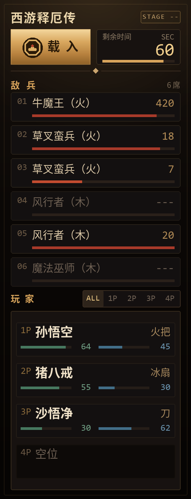

# 西游释厄传 · 内存看板

原易语言程序的 Rust + egui 重构版。挂在 FBA-rr / FBAS 模拟器外面，实时读出关卡剩余时间、
四个玩家槽位的血量和当前道具、六个敌兵的血量。

窗口固定 **250×650**，侧边一竖条常驻，不挡游戏。

## 界面



250×650 的暗漆金线面板，每一块都是拿 `Painter` 按坐标算出来的，没有用控件布局：

* **顶部区**：左边「西游释厄传」+ 关卡章（`STAGE 3` = 第 3 关，读不到关号是 `STAGE --`），
  下面是「载入」按钮和剩余时间卡。标志放在「载入」按钮里（墨色圆底 + 金色图形，
  直接压在金色按钮上看不清，所以垫了一层印面）。
* **敌兵六席**：`01 牛魔王（火）  420` 加一条血条，标题右侧报「场上还剩几只」
  （有在场标志且血 > 0，和逐行显示的数字同口径）。兵种名来自 `offsets.yaml` 的
  `enemy_types`（44 种），表里没有的类型直接显示 6 位编号。
  空槽显示 `—` 和 `---`，整行灰掉——判定看的是**在场标志**（`enemy_fields.active`，
  0 空槽 / 2 有兵），不是血量：死槽会留着上一波的血量 / 坐标 / 种类。
* **玩家区**：「ALL / 1P / 2P / 3P / 4P」五档切换。
  * ALL：四行，`1P 孙悟空 … 火把` 加双色血 / 气条，空位显示灰字。
  * 详情：印章首字 + 角色名 + 血 / 气 + 3×3 道具环，右上角单独给出「当前道具」
    的名字和数量，道具环里光标正指着的那一格会亮起来（金色描边 + 底色提亮）。
* 鼠标停在载入按钮上会显示模拟器名、PID 和 RAM 首地址，平时不占版面。

道具那一圈不是按顺时针填的：**落点随道具总数变化**，同一件道具在 2 件和 3 件时
位置都不一样（游戏就是这么显示的），所以照抄成一张 1~8 件的表，见 `items::LAYOUTS`。
两条硬约束：中排正中永远空着，正中一格永远是人物。

判断「这个位置有没有人」看的是**玩家结构的第一个字节**（`player_fields.active`，
相对血量锚点 `-0x57`，也就是从 `0x1BE41` 起、间隔 `0x13E` 的那一排）：
`0` = 空槽，`2` = 这个位置有人。

不能看角色 ID：空槽读出来也是 `0`，而 `0` 恰好是孙悟空的编号，会把空位显示成悟空。
也不能看血量：空槽会留着上一局的 72 / 68。

## 从源码构建

**前置条件**（只列必须的）：

| 项 | 要求 | 说明 |
|---|---|---|
| 系统 | Windows 10 / 11，x64 | 依赖 `ReadProcessMemory` 和 OpenGL，别的平台跑不了 |
| Rust | stable 1.85 以上 | `Cargo.toml` 用 `edition = "2024"` |
| 工具链 | **MSVC**，不是 GNU | `rustup default stable-x86_64-pc-windows-msvc`；GNU 工具链下 `.cargo/config.toml` 里的 `+crt-static` 和 `/STACK` 链接参数对不上 |

三条命令：

```bash
git clone https://github.com/Ruan-XH/xiyou-trainer.git
cd xiyou-trainer
cargo run          # 先看界面（模拟器没开也能起，会显示「未找到模拟器」）
cargo test --workspace   # 本体 31 项 + winmem 9 项 + 2 项文档测试
```

发版（build + 写 exe 图标，**别用裸的 `cargo build --release`**，图标会丢）：

```bash
powershell -ExecutionPolicy Bypass -File tools\build-release.ps1
```

产物在 `target/release/xiyou-trainer.exe`，约 6 MB，直接加图标那种「拷走就能双击」的单文件。

仓库是**自包含**的：唯一一个非 crates.io 的依赖是跨进程读写库 `winmem`，已经放在
`crates/winmem/` 里，不用另外 clone 什么。它也是普通 crate，可以单独 `cd` 进去
`cargo run --example self_test` 自测。

第一次编译会拉 `eframe` 一整套（glow / winit / egui），几百个 crate，慢一点是正常的；
之后增量编译几秒。磁盘上 `target/` 会到 8G 上下，嫌大就 `cargo clean`，随时能重建。

## 跑起来

```bash
cargo run                 # 需要 Fba.exe 或 Fbas.exe 正在运行
cargo run --release       # 正式用的版本
```

没装模拟器也能看界面：

```bash
# PowerShell
$env:XIYOU_DEMO=1; cargo run
# bash
XIYOU_DEMO=1 cargo run
```

程序每 100ms 轮询一次，先按配置里的顺序找模拟器进程。**进程掉线会自动重连**，
模拟器重开不用重启看板。

release 版是 Windows 图形子系统（`windows_subsystem = "windows"`），双击 exe
不会再跟着弹一个黑框；debug 版保留控制台，方便看字体加载和配置报错。
带参数启动（`--dump-offsets` 等）时会先 `AttachConsole` 接回父进程的控制台，
所以命令行用法照旧能看输出——从 cmd / PowerShell 里跑即可。

---

## 只发一个 exe 给别人用

可以。`config/offsets.yaml` 是 `include_str!` 编进 exe 的，**exe 单独拷走就能跑**，
不需要带 `config/` 目录（放了才会覆盖内置值，见下一节）。

依赖只剩 Windows 自带的系统 DLL，没有 `VCRUNTIME140.dll` 这类可再分发的运行库：

```
kernel32  user32  gdi32  shell32  ole32  dwmapi  imm32  uxtheme
ntdll  bcryptprimitives  OPENGL32  api-ms-win-core-synch-l1-2-0
```

（`.cargo/config.toml` 里的 `target-feature=+crt-static` 负责把 C 运行库静态链进来。
去掉它，没装过 VC++ 2015-2022 运行库的机器会报「找不到 VCRUNTIME140.dll」。）

对方需要知道的几件事：

* **必须是 64 位 Windows 10 及以上**（Win7 要装 UCRT，没试过）。
* **模拟器进程名得是 `fba.exe` / `fbas.exe`**。用别的模拟器要改配置——把
  `config/offsets.yaml` 放到 exe 同目录就行，程序优先读它。
* **权限要对齐**。看板读的是别的进程的内存：FBA 用管理员启动时，看板也得用管理员启动，
  否则会一直显示「未找到模拟器」。
* **SmartScreen 会拦一次**。exe 没有代码签名，从微信/QQ 传过去的文件第一次运行会弹
  「Windows 已保护你的电脑」，点「更多信息 → 仍要运行」。少数杀软可能因为
  `ReadProcessMemory` 试探性报毒，加白名单即可。
* **中文字体**：优先用黑体（XP 起系统自带，小字号下最干净），没有则依次退
  Noto Sans SC / 雅黑 / 宋体；标题同正文一套（黑体没有独立粗体，靠字号和颜色分层）。
  换字体时字面大小会跟着变一点（黑体比雅黑窄一圈，宋体最虚），不影响功能。

---

## 地址都在 `config/offsets.yaml`

**代码里没有写死任何地址。** 所有基址、偏移、字段类型都在 `config/offsets.yaml`，
程序启动时读它；改完保存、重启看板即可生效，不用重新编译。

查找顺序（找到第一个存在的就用）：

1. 环境变量 `XIYOU_OFFSETS` 指向的文件
2. exe 同级的 `config/offsets.yaml`
3. exe 往上两级的 `config/offsets.yaml`（`target/debug/` 跑的时候用这条）
4. 当前工作目录的 `config/offsets.yaml`（`cargo run` 用这条）
5. 都没有就用编译进二进制的内置副本

文件存在但写错时**不会**静默回退——会带着红字提示「配置加载失败」并说明哪一行哪一列错了，
同时用内置副本继续跑。所以不会出现「改了半天其实没生效」。

### 数值怎么写

```yaml
time: 0xC06F      # 十六进制，推荐
time: 49263       # 十进制，一样
time: "0xC06F"    # 加引号当字符串，程序也认
rel: -0xACFC      # 负数直接写
```

三种写法等价。地址一律用大写 `0x` 十六进制更清楚。
YAML 用 `#` 写注释，`config/offsets.yaml` 里每一段都有注释说明，改之前先看一眼。

### 几个区块

**`emulators`** —— 支持哪些模拟器、各自 RAM 指针在哪。
`ram_ptr_offset` 是「RAM 指针」这个变量相对模块基址的位置，读出来就是模拟 RAM 的首地址。
加新模拟器只要往数组里加一条，程序会按顺序尝试。

**`layout` + `player_fields`** —— 玩家结构的布局。
`player_anchor` 是 1P 血量地址，其余字段的 `rel` 都相对它，可为负。
`scale` 决定这个字段按哪一套间距递推：

- `player` → `stride_player`（在场标志 / 血量 / 气槽 / 角色 ID）
- `item` → `stride_item`（道具光标 / 道具环）
- `none` → 不递推

其中 `active` 是「在场标志」：`0` 空槽、`2` 有人，界面判定有没有人只看它。
它在结构里的位置比血量早 `0x57`，所以 `rel` 是负的。

**`enemy_fields`** —— 敌兵结构：`active` 在场标志（0 空槽 / 2 有兵，比血量早 `0x57`）、
`hp` 血量、`x` 坐标（调试用）、`type` 种类（对象定义指针，同种敌人相同，死亡不清零）。
四个字段都相对 `enemy_anchor`。判断这槽有没有活兵只看 `active`。

**`watches`** —— 你自己找到的地址放这里，看板底部会实时显示。空数组也可以（就不显示那一条）。

### 加一条新地址

在 `config/offsets.yaml` 的 `watches` 里加一条，保存重启就出现在底部「自定义监视」条上：

```yaml
watches:
  - id: boss_hp
    name: BOSS 血量
    desc: 第七关 BOSS，血条读不出来时用这个
    type: u16
    address:
      base: ram
      offset: 0x011A88
```

`type` 可选 `u8` `i8` `u16` `i16` `u32` `i32` `u64` `f32` `f64`。

`address` 支持三种写法，按需要叠加：

| 想表达的 | 写法 |
|---|---|
| RAM 首地址 + 固定偏移 | `base: ram` + `offset: 0x1234` |
| 相对模拟器模块基址 | `base: module` + `offset: 0x1120518` |
| 按玩家序号取字段（0 就是 1P） | `offset: 0x1BE98` + `scale: player` + `index: 1` |
| Cheat Engine 的指针链 `[[基址]+0x10]+0x8` | `offset: 0x100` + `deref: [0x10, 0x8]` |

`deref` 每多一项就多读一次 u32 指针，最多 8 层（超过会当成写错报出来）。
指针链断在空指针上时，界面那条会显示红色「指针为空」而不是整块数据不刷新。

### 校验一下再跑

```bash
cargo run -- --dump-offsets                 # 按假想基址打印所有地址
cargo run -- --dump-offsets 0x04000000      # 指定假想的 RAM 基址
```

它会走和看板完全相同的加载、校验、解析逻辑，把每个字段落在哪个地址列出来。
**加了新地址先用这个看一遍**，地址算错了一眼就能发现。配置有问题时退出码是 1，
方便脚本里判断。

### 导出绝对地址（给 CE 用）

偏移本身没法直接粘进 Cheat Engine，得先知道这次的 RAM 首地址。游戏开着的时候跑：

```bash
cargo run -- --addresses          # 连上在跑的 fba.exe，写入 config/addresses.yaml
cargo run -- --addresses -        # 同上，打到标准输出
cargo run -- --addresses out.yaml # 指定输出路径
```

生成的文件长这样，每行一个绝对地址，注释写清是什么：

```yaml
ram_base:    0x187B9020   # 模拟 RAM 首地址
players:
  p1:
    hp:        0x187D4EB8   # 1P 血量，u16
    qi:        0x187D4F6D   # 1P 气槽，u8（上限 96）
```

⚠️ RAM 首地址是模拟器启动时申请的堆内存，**重启模拟器就会变**，所以这份是快照，
重启后重新生成一次即可。长期有效的是 `config/offsets.yaml` 里的相对偏移。

---

## 地址一览（默认配置）

下面这些就是 `config/offsets.yaml` 里的值，列出来方便对着 CE 看。

| 项 | 偏移 | 类型 | 说明 |
|---|---|---|---|
| RAM 指针（FBA-rr） | `0x01120518` | u32 | 相对模块基址 |
| RAM 指针（FBAS） | `0x00A7CC64` | u32 | 相对模块基址 |
| 剩余时间 | `+0xC06F` | u8 | 相对 RAM 首地址 |
| 关卡号 | `+0xC03B` | u8 | **0 基**（第 1 关 = 0），显示时 +`stage_bias`；读不到是 `STAGE --` |
| 1P 血量 | `+0x1BE98` | u16 | 也是其余玩家字段的锚点 |
| 气槽 | 锚点 `+0xB5` | u8 | 上限 96 |
| 在场标志 | 锚点 `-0x57` | u8 | 0 空槽 / 2 有人；**界面用它判断有没有人**（即 `0x1BE41` 那一排） |
| 角色 ID | 锚点 `-0x0C` | u8 | 0 悟空 / 1 八戒 / 2 悟净 / 3 小龙女 / 4 龙马；只用来显示名字（即 `0x1BE8C` 那一排） |
| 道具光标 | 锚点 `-0xACFC` | u8 | 0 基，按 item 间距递推 |
| 道具环 | 锚点 `-0xAD0D` | u8 | 每件 2 字节 `[数量][ID]`，总数在 `+18` |
| 敌兵在场标志 | 敌锚点 `-0x57` | u8 | 0 空槽 / 2 有兵；**界面用它判断有没有兵**（即 `0x11A31` 那一排） |
| 敌兵血量 | `+0x11A88` | u16 | 6 个，按 `stride_player` 递推 |
| 敌兵 X 坐标 | 敌锚点 `-0x2B` | u8 | 调试用，不参与存活判定 |
| 敌兵种类 | 敌锚点 `-0x34` | u32 | 对象定义指针，同种相同 |
| 玩家间距（血量/气/角色/在场） | `0x13E` | | |
| 玩家间距（光标/道具） | `0x7E` | | **注意和上面不是一个值** |

⚠️ 一个容易踩的坑：光标和道具环是**负偏移，基准是 1P 的锚点**，只按 `0x7E` 递推，
不能拿各自的血量地址去减——那样会把两个间距叠加，2P 往后地址直接跑飞。
这条有单元测试守着；配置里 `scale` 写错的话，`--dump-offsets` 输出的地址会明显不对。

### 取址原理

FBA 是模拟器，游戏数据活在它模拟出来的 RAM 里，所以是两级跳：

```
模块基址 + ram_ptr_offset  →  读 u32  →  RAM 首地址
RAM 首地址 + 字段偏移      →  字段
```

玩家字段再多一层：`RAM 首地址 + player_anchor + rel + 序号 × 间距`。

## 和原版的差别

保留的：偏移表、道具 ID 表、100ms 刷新、气槽上限 96、敌军 6 个。

改掉的：

| 原版 | 现在 | 为什么 |
|---|---|---|
| 只显示 1P（2P–4P 整段注释掉了） | 四个槽位都读，没人就显示「空位」 | 原版判断写的是 `临时角色 > -1`，而字节读出来恒 ≥ 0，等于没判；现在读在场标志（0 空 / 2 有人） |
| 横版大窗口（960×680），一屏塞所有人 | 竖版 250×650，纯文字 + 自绘面板 | 侧边一竖条常驻，不挡游戏 |
| 进程消失就把时钟置 0、停掉 | 继续轮询，自动重连；也能点「重载」手动来一次 | 模拟器重启不用重开看板 |
| 空槽读出来的垃圾血条照样显示 | 灰底「空位」 | 见上：用在场标志判断 |
| 道具靠嵌套 `如果` 拼空格字符串摆位置 | 3×3 的环，落点照抄原版那张表（`items::LAYOUTS`） | 游戏里道具落点不按顺时针排，同一件在 2 件 / 3 件时位置都不一样，只能查表 |
| 偏移写死在源码里 | 全在 `config/offsets.yaml` | 找新地址不用重编译 |

## 代码结构

```
assets/logo_src.png      标志原图（换 LOGO 只认这一个文件）
assets/logo.png          256×256 留档
assets/logo.ico          多尺寸 exe 文件图标
assets/icon64.rgba       裸 RGBA，编译期 include 进 exe 当窗口图标
config/offsets.yaml      所有基址与偏移（改这个就行，不用动代码）
config/addresses.yaml    上一次 --addresses 生成的绝对地址快照（可随时覆盖，不入库）
crates/winmem/           跨进程读写库，独立 crate（读内存 / 枚举模块 / AOB 扫描）
tools/make_icon.py       源图 → png / ico / rgba 三件套
tools/set-exe-icon.ps1   把 ico 写进 exe 资源段
tools/build-release.ps1  release + 写图标，一步到位
tools/shot.py            截图小工具（开发时看布局用）
src/
├── main.rs              入口、窗口、--dump-offsets / --addresses
├── app.rs               整个界面：100ms 轮询 + 画那十块面板
├── game/
│   ├── config.rs        YAML 加载 / 校验 / 地址表达式解析
│   ├── addresses.rs     连上进程算绝对地址，输出 addresses.yaml
│   ├── items.rs         道具 ID 表 + 3×3 环的落点表（按总数查）
│   ├── snapshot.rs      附加进程、读一份快照、读监视项
│   └── demo.rs          演示数据
```

数据层（`game/`）完全不依赖 egui，可以单独复用或跑测试；`app.rs` 只管画。

## 换 LOGO

```bash
python tools/make_icon.py 新图.png        # 生成 assets/ 下的 png / ico / rgba
powershell -ExecutionPolicy Bypass -File tools\build-release.ps1
```

`make_icon.py` 会自己拼 ICO：16~128 用 BMP(DIB) 帧，256 用 PNG。**别用 Pillow 的
`save(format="ICO")`**——它把所有尺寸都存成 PNG 帧，GDI+（System.Drawing、不少资源编辑器）
读到就报「不是可用的 Icon 图片」。

exe 的文件图标不是链接期打进去的：这台机器上没有 `rc.exe` / `windres`，`embed-resource`
这类 crate 跑不起来，所以 `set-exe-icon.ps1` 走 Win32 的 `BeginUpdateResource` /
`UpdateResource` 直接往 exe 资源段里写。**cargo 每次重新链接都会覆盖 exe，图标会丢**，
所以发布一律用 `build-release.ps1`（它先 build 再写图标）。窗口和任务栏图标不受影响，
那是 `with_icon()` 在运行时设置的，素材是 `assets/icon64.rgba`。


## 已知限制

- **只读**。这版和原版一样只看不改，没有写内存的功能。
- 默认偏移对应 4P 版 ROM / 关卡内数据。换 ROM、换游戏版本、在标题画面时都会读不到
  （此时状态栏会写「RAM 指针为 0x0，游戏可能还没进关」）。
- 玩家字段的读取宽度（u16 / u8）在代码里是固定的，配置里 `type` 写成别的会直接报错，
  而不是悄悄忽略。
- 道具环容量固定 8，配置里写别的也会报错。
- **敌兵在场标志会滞后约 1.2 秒**。血量归零后它还留在 2（死亡动画期间人仍在屏幕上），
  等槽位真正释放才归 0。这个滞后正好对应「怪还没消失」，所以没有补偿。
- 气槽上限、角色 ID 都在读（`game/snapshot.rs` 里读全了），只是这版界面没地方显示；
  以后要加一行文字随时能用。道具总数已经用上了——它决定 3×3 环上每件道具的落点。
- 没用 DBVM / 内核驱动，纯用户态 `ReadProcessMemory`，需要和模拟器同权限级别运行
  （模拟器如果以管理员启动，看板也要以管理员启动）。

## 依赖

- `eframe` / `egui` 0.37 —— 即时模式界面，只开 glow 后端，不带 wgpu
- `serde` / `serde_yaml` —— 读配置文件
- `winmem`（`crates/winmem`，本人写的跨进程读写库，只依赖 `windows` 0.62）

测试：`cargo test --workspace` —— 本体 31 项（地址算术、配置校验、道具落点表，
其中一条真的读自己进程的内存来验证类型分派），winmem 9 项 + 2 项文档测试。
只跑本体用 `cargo test`，只跑 winmem 用 `cargo test -p winmem`。
